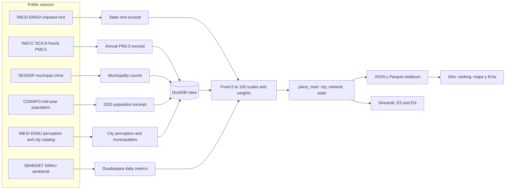

Sitio público: https://eflores1122.github.io/mx-open-air-quality/

# Vivir en México

Comparación cívica para leer, en el mismo tablero, el aire, una renta aproximada y la seguridad de ciudades y entidades de México. Creció a partir de **Aire abierto**, la lectura del SIMAJ de Guadalajara, que sigue en el mismo tablero y en el mismo paquete de Python.

El repositorio y el paquete siguen llamándose `aire-abierto` / `aire_abierto`. El nombre más amplio, en la interfaz y en este texto, es **Vivir en México** (`mx-livability`). El código es MIT. Los datos no: cada cifra se queda con quien la publicó.

A civic comparison of air, approximate rent, and safety for cities and states in Mexico. It grew out of **Aire abierto**, the Guadalajara SIMAJ reading, which is still in the same dashboard and the same Python package.

The repository and the package are still named `aire-abierto` / `aire_abierto`. The broader name, in the interface and in this text, is **Living in Mexico** (`mx-livability`). The code is MIT. The data are not: each figure stays with its publisher.

Esto no es consejo para mudarse, ni un parte oficial, ni una evaluación de riesgo personal. This is not advice about where to move, not an official bulletin, and not a personal risk assessment.

Se preparó como herramienta de interés público junto con Edgar Flores.

## Español

### Para qué sirve

Tres preguntas, con la fuente al lado de cada número:

1. ¿Qué PM2.5 anual publica la red de monitoreo de esa ciudad, cuando la red existe?
2. ¿Cuál es la tasa de homicidio doloso más feminicidio por 100 mil, y qué dice la ENSU de quien siente insegura su ciudad?
3. ¿Qué alquiler imputado promedio trae la ENIGH para el estado, como aproximación de costo, no como anuncio?

La renta y la calidad van separadas a propósito. Un puntaje único se puede armar con pesos, y esos pesos se mueven en el sitio y en el tablero.

### Cómo correrlo

```bash
python -m venv .venv
source .venv/bin/activate
pip install -e ".[dev]"

# Mart nacional, sin red: usa los extractos de data/livability/samples
python -m aire_abierto.livability.pipeline --source sample

# El archivo horario de Guadalajara, si se quiere reconstruir
python -m aire_abierto.pipeline --source sample --out build/excerpt

# Tablero en http://127.0.0.1:8741
streamlit run dashboard/app.py
```

El sitio público es la página estática del enlace de arriba. Lee `site/data/place_mart.json` y `site/data/place_mart.parquet`, el mismo mart. Los pesos, el ranking, el mapa y la ficha corren en el navegador. Para volver a escribir esos archivos después de armar el mart:

```bash
python -m aire_abierto.livability.webexport
```

En el tablero, la primera lectura es «Vivir en México». «Aire en Guadalajara» abre la serie horaria del SIMAJ.

Sin red, y con datos inventados a la vista:

```bash
python -m aire_abierto.livability.pipeline --source synthetic --out build/livability-synthetic
python -m aire_abierto.pipeline --source synthetic --out build/synthetic
```

`--source live` vuelve a pedir SINAICA, el almacén de datos del SESNSP, CONAPO y los PDF de la ENSU. Tarda, porque el aire baja red por red. `--source auto` intenta eso y, si falla, usa los extractos. CI no usa la red.

Para refrescar solo los extractos: `python -m aire_abierto.livability.download --out data/livability/samples`. El catálogo de municipios de la ENSU pide el paquete opcional `pdfplumber`. La ENIGH no se vuelve a bajar sola: la tabla oficial abre con JavaScript. El archivo comprometido y su procedencia están en `data/livability/samples/PROVENANCE.md`.

### Qué sale de los extractos de este repositorio

Cifras del mart `data/livability/metrics`. Los extractos se bajaron el 5 de noviembre de 2026. El 10 de noviembre se corrigió el catálogo de Saltillo y de Zacatecas y se volvió a armar el mart. No son un ranking para elegir casa.

Cobertura: **152 lugares** (91 ciudades ENSU, 32 entidades, 29 redes de monitoreo que no se pegaron a una sola ciudad). Hay PM2.5 en 39 lugares, tasa delictiva en 151, percepción en las 91 ciudades y renta estatal en 149. La Laguna, Tampico y la zona metropolitana del Valle de México no reciben una renta de un solo estado. Saltillo sí tiene tasa: el municipio de Ramos Arizpe ya entra con su clave de 5 dígitos.

- **Aire.** La red SIMAT del Valle de México, 2023, tiene mediana anual de PM2.5 de **20.4 µg/m³** (10 estaciones con suficientes días; la peor, 23.8). Monterrey, red metropolitana, 2022: **20.4** (12 estaciones; la peor, 28.9). Tijuana, 2022: **34.4** (2 estaciones). Ciudad Juárez, 2022: **39.9**, y es una sola estación. Guadalajara en SINAICA, 2022: **29.9**, también una sola estación de siete en el archivo. El archivo SEMADET de 2025, leído aparte, da una mediana de **19.2 µg/m³** en 6 estaciones con suficientes días. Ese 19.2 no entra al puntaje nacional: las redes se comparan con SINAICA. Veintisiete de las 39 cifras de aire salen de una sola estación. Un año viejo también cuenta: Aguascalientes usa 2018 porque los años más nuevos no cubrieron el 75% de los días.
- **Delitos, 2025, por 100 mil.** La suma de homicidio doloso y feminicidio, ya cruzada con la población CONAPO de mitad de 2025, es **15.5** en el país (20,649 muertes sobre 133,367,428 personas; el archivo trae 28 muertes más en municipios que no están en esa población). Yucatán **1.7**. Ciudad de México **8.4**. Jalisco **11.1**. Colima **73.0**, la entidad más alta de este corte. En ciudades ENSU: Mérida **1.8** (percepción de inseguridad **31.5%**), Zapopan **6.9** (percepción **53.1%**), Guadalajara **11.2** (percepción **82.9%**), Tijuana **50.7**, Juárez **47.6**, la ciudad ENSU de Colima **70.3** (Colima y Villa de Álvarez), Culiacán Rosales **83.3** (percepción **90.6%**). San Pedro Garza García publica **0** homicidios dolosos y **0** feminicidios, y **31** extorsiones: la extorsión no entra al puntaje, y un cero en un municipio de unos 123 mil habitantes no es una prueba de que no pase nada.
- **Renta aproximada, ENIGH 2024.** Alquiler imputado trimestral por hogar, dividido entre 3. Chiapas **1,501 pesos**. Yucatán **2,885**. Jalisco **3,231**. Nuevo León **4,137**. Ciudad de México **6,025**. Dos ciudades del mismo estado comparten el número. No es la renta de un anuncio y no dice si el salario local alcanza.
- **Puntaje.** Con los pesos de origen (aire 0.40, delitos 0.35, percepción 0.25) hace falta más de una de esas piezas. Por eso una entidad que solo tiene tasa no queda arriba de una ciudad medida por dos lados. Mérida, sin PM2.5 en este corte, queda en **85.6**. Tijuana, con aire, tasa y percepción, queda en **23.1**. El puntaje que además mete la renta (pesos 0.30 / 0.30 / 0.20 / 0.20) sube a quien tiene alquiler imputado bajo. Conviene mirar la gráfica de costo contra calidad, no solo la barra.

### Guadalajara, el archivo de 2025

El tablero de «Aire en Guadalajara» sigue leyendo el horario público de SEMADET. Estas cifras salen de `data/metrics`, con las bandas de partículas vigentes desde enero de 2026, no la clasificación que regía durante 2025.

- 13 estaciones, 113,880 horas, 365 días civiles.
- En **309 de 365 días** al menos una estación cayó en Mala o peor. Solo 10 días quedaron en Buena en toda la red, bajo esta regla.
- Eso es la peor estación del día. La mediana diaria de PM2.5 entre estaciones con datos suficientes tuvo, a su vez, una mediana de unos **18 µg/m³**.
- **Santa Fe** sumó 254 días en Mala o peor. **Las Pintas** sumó 237. **Santa Margarita** tuvo el PM2.5 medio más bajo, unos 11 µg/m³.
- El dióxido de azufre no trae número válido en el 63% de las horas. En Miravalle el canal de PM2.5 no tiene ni un día con 18 horas válidas.

No dice cómo está el aire ahora. Para hoy hay que abrir el [reporte horario de SEMADET](https://aire.jalisco.gob.mx/).

```bash
python -m aire_abierto.pipeline --source live --year 2025
```

### Fuentes

| Qué | Quién | Dónde | Corte | Licencia |
| --- | --- | --- | --- | --- |
| PM2.5 horario validado por red | INECC, SINAICA / SCICA | [Descarga](http://scica.inecc.gob.mx/exec/datadl) | El año más reciente con una estación completa; en este corte, 2018–2023 | La página no da una licencia SPDX. Atribuido al INECC |
| Horario O3, NO2, SO2, CO, PM10, PM2.5 de Guadalajara | SEMADET, SIMAJ | [BD_2025.xlsx](https://aire.jalisco.gob.mx/reportes/BD_2025.xlsx) | 2025 | La página no da una licencia SPDX. Atribuido a SEMADET. No entra al puntaje nacional |
| Bandas del tablero de Guadalajara | SEMARNAT | NOM-172-SEMARNAT-2023, DOF 25 de enero de 2024 | Partículas: columna «A partir de enero de 2026» | Norma publicada |
| Incidencia delictiva municipal | SESNSP | [datos.gob.mx](https://www.datos.gob.mx/dataset/incidencia_delictiva) | 2025, año completo en los doce meses | CC BY 4.0 |
| Población a mitad de año | CONAPO | [Proyecciones](https://www.datos.gob.mx/dataset/proyecciones-de-poblacion) | 2025, municipios | Datos abiertos en datos.gob.mx. Atribuido a CONAPO |
| Percepción de inseguridad por ciudad | INEGI, ENSU | [Presentación diciembre 2024](https://www.inegi.org.mx/contenidos/programas/ensu/doc/ensu2024_diciembre_presentacion_ejecutiva.pdf) | Diciembre de 2024, 91 ciudades | Términos de uso del INEGI. Atribuido al INEGI |
| Municipios de cada ciudad ENSU | INEGI, ENSU | [Catálogo 2025](https://www.inegi.org.mx/contenidos/programas/ensu/doc/ensu2025_catalogo_ciudades_interes.pdf) | Catálogo 2025; Torreón y Fresnillo se completaron con la composición de 2024 | Términos de uso del INEGI |
| Alquiler imputado por entidad | INEGI, ENIGH 2024 | [Tabulado](https://www.inegi.org.mx/app/tabulados/interactivos/?pxq=Hogares_Hogares_11_861f5732-c3db-4614-be03-741f649d605c) | 2024, promedio trimestral por hogar | Términos de uso del INEGI. Transcripción del tabulado publicado |

El detalle de cada archivo, con lo que no se pudo bajar, está en [`data/livability/samples/PROVENANCE.md`](data/livability/samples/PROVENANCE.md). No se entra a páginas con login ni se usan APIs de pago. OpenAQ pide una llave y aquí no se usa.

### Metodología

El puntaje de cada pieza va de 0 a 100. Más alto quiere decir menos carga medida, no una mejor vida.

| Pieza | 100 | 0 | Notas |
| --- | --- | --- | --- |
| Aire | 5 µg/m³ de PM2.5 anual o menos | 35 µg/m³ o más | Escala de este proyecto. No es el Índice AIRE y SALUD ni la NOM-172, que es un índice diario |
| Delitos | 0 por 100 mil | 80 por 100 mil | Homicidio doloso + feminicidio. Por encima de 80 el puntaje se queda en 0 y la tasa sigue visible. Secuestro y extorsión se publican y no entran |
| Percepción | 0% se siente inseguro | 100% | ENSU, diciembre de 2024. El margen de error por ciudad es amplio |
| Renta | 2,000 pesos al mes o menos | 6,000 o más | Trimestral de la ENIGH / 3. Es alquiler imputado estatal |

Calidad, sin renta: aire 0.40, delitos 0.35, percepción 0.25. Hace falta más de una pieza; si falta alguna, el peso se reparte entre las que sí están. Puntaje combinado, con renta: 0.30, 0.30, 0.20 y 0.20, también con al menos dos piezas. En el sitio y en el tablero esos cuatro pesos se mueven.

La tasa sale en DuckDB: suma de casos y de población de los municipios del lugar, por 100 mil. Si falta más del 10% de esos municipios en alguno de los dos archivos, la tasa se deja vacía.

La geografía no es la misma en las tres columnas. El catálogo ENSU dice qué municipios entran en la ciudad (a veces varios; La Laguna cruza Coahuila y Durango). La red SINAICA a veces es una ciudad, a veces la zona metropolitana, a veces el estado. Cuando el nombre de la red es el de la ciudad, el PM2.5 se muestra en esa ciudad y la nota dice que puede no cubrir todos sus municipios. La ZMG y Monterrey quedan como redes: el aire es el de la red y la tasa suma las ciudades ENSU listadas en `data/livability/reference/networks.csv`, que no es la delimitación metropolitana oficial completa. La SIMAT del Valle de México solo trae aire: cruza dos entidades y aquí no se inventa una tasa única. La renta, cuando aparece, es siempre la del estado.

### Qué no es

No es consejo para elegir ciudad. No es el índice oficial del aire ni un parte de hoy: hay redes cuyo último año útil es 2018. No es un censo del delito: es lo que las fiscalías registraron. No es la renta que vas a pagar. No es una lectura de crédito, de hipoteca ni de pagos. No se armó un índice de precios de vivienda de la SHF porque no apareció un archivo público estable en esta construcción, y un índice no se convierte aquí en pesos.

## English

### What it is for

Three questions, with the source next to each number:

1. What annual PM2.5 does that city's monitoring network publish, when a network exists?
2. What is the rate of intentional homicide plus feminicide per 100,000, and what does ENSU say about people who feel their city is unsafe?
3. What imputed rent does ENIGH give the state, as a cost approximation, not as a listing?

Rent and quality stay apart on purpose. A single score can be built with weights, and those weights move on the site and in the dashboard.

### How to run

```bash
python -m venv .venv
source .venv/bin/activate
pip install -e ".[dev]"

# National mart, offline: uses the excerpts in data/livability/samples
python -m aire_abierto.livability.pipeline --source sample

# Guadalajara hourly file, if you want to rebuild it
python -m aire_abierto.pipeline --source sample --out build/excerpt

# Dashboard at http://127.0.0.1:8741
streamlit run dashboard/app.py
```

The public site is the static page at the top of this file. It reads `site/data/place_mart.json` and `site/data/place_mart.parquet`, which are the same mart. Weights, the ranking, the map, and the city sheet run in the browser. Regenerating those files after a mart build:

```bash
python -m aire_abierto.livability.webexport
```

In the dashboard, the first view is "Living in Mexico". "Air in Guadalajara" opens the SIMAJ hourly series.

Offline, with invented rows clearly marked:

```bash
python -m aire_abierto.livability.pipeline --source synthetic --out build/livability-synthetic
python -m aire_abierto.pipeline --source synthetic --out build/synthetic
```

`--source live` fetches SINAICA, the SESNSP datastore, CONAPO, and the ENSU PDFs again. It takes a while, because air is downloaded network by network. `--source auto` tries that and falls back to the excerpts. CI never uses the network.

To refresh only the excerpts: `python -m aire_abierto.livability.download --out data/livability/samples`. The ENSU municipality catalog needs the optional `pdfplumber` package. ENIGH is not re-downloaded on its own: the official table needs a browser. The committed file and its trail are in `data/livability/samples/PROVENANCE.md`.

### What these excerpts show

Figures from the mart in `data/livability/metrics`. The excerpts were downloaded on 5 November 2026. On 10 November the Saltillo and Zacatecas catalog rows were corrected and the mart was rebuilt. They are not a ranking for choosing a home.

Coverage: **152 places** (91 ENSU cities, 32 states, 29 monitoring networks that were not attached to a single city). PM2.5 is present for 39 places, a crime rate for 151, perception for all 91 cities, and state rent for 149. La Laguna, Tampico, and the Mexico City metro area do not receive one state's rent. Saltillo does have a rate: Ramos Arizpe is now joined on its 5-digit code.

- **Air.** The Mexico City SIMAT network, 2023, has an annual median PM2.5 of **20.4 µg/m³** (10 stations with enough days; the worst, 23.8). Monterrey's metro network, 2022: **20.4** (12 stations; the worst, 28.9). Tijuana, 2022: **34.4** (2 stations). Ciudad Juárez, 2022: **39.9**, from a single station. Guadalajara in SINAICA, 2022: **29.9**, also one station out of seven in the file. The SEMADET file for 2025, read separately, gives a median of **19.2 µg/m³** across 6 stations with enough days. That 19.2 is not in the national score: networks are compared with SINAICA. Twenty-seven of the 39 air figures come from a single station. An old year counts too: Aguascalientes uses 2018 because later years did not cover 75% of days.
- **Crime, 2025, per 100,000.** Intentional homicide plus feminicide, joined to CONAPO's mid-2025 population, is **15.5** nationally (20,649 deaths over 133,367,428 people; the file has 28 further deaths in municipalities absent from that population). Yucatán **1.7**. Mexico City **8.4**. Jalisco **11.1**. Colima **73.0**, the highest state in this cut. Among ENSU cities: Mérida **1.8** (insecurity perception **31.5%**), Zapopan **6.9** (perception **53.1%**), Guadalajara **11.2** (perception **82.9%**), Tijuana **50.7**, Juárez **47.6**, the ENSU city of Colima **70.3** (Colima and Villa de Álvarez), Culiacán Rosales **83.3** (perception **90.6%**). San Pedro Garza García publishes **0** intentional homicides and **0** feminicides, and **31** extortion records: extortion is not in the score, and a zero in a municipality of about 123,000 people is not proof that nothing happened.
- **Approximate rent, ENIGH 2024.** Quarterly imputed rent per household, divided by 3. Chiapas **1,501 pesos**. Yucatán **2,885**. Jalisco **3,231**. Nuevo León **4,137**. Mexico City **6,025**. Two cities in the same state share the number. It is not a listing and it does not say whether local earnings cover it.
- **Score.** With the default weights (air 0.40, crime 0.35, perception 0.25) more than one of those pieces is required. A state that only has a rate is not ranked above a city measured on two sides. Mérida, with no PM2.5 in this cut, scores **85.6**. Tijuana, with air, a rate, and perception, scores **23.1**. The score that also includes rent (weights 0.30 / 0.30 / 0.20 / 0.20) lifts places with low imputed rent. The cost-versus-quality chart is the safer reading.

### Guadalajara, the 2025 file

The "Air in Guadalajara" view still reads SEMADET's public hourly file. These figures come from `data/metrics`. Particle bands are the ones in force since January 2026, not the classification used during 2025.

- 13 stations, 113,880 hours, 365 civil days.
- On **309 of 365 days** at least one station was Poor or worse. Only 10 days were Good everywhere on the network, under this rule.
- That is the worst station of the day. The daily median of PM2.5 across stations with enough hours itself had a median of about **18 µg/m³**.
- **Santa Fe** had 254 days at Poor or worse. **Las Pintas** had 237. **Santa Margarita** had the lowest mean PM2.5, about 11 µg/m³.
- Sulfur dioxide has no valid number in 63% of hours. At Miravalle the PM2.5 channel has not a single day with 18 valid hours.

It does not say what the air is like right now. For today, open [SEMADET's hourly report](https://aire.jalisco.gob.mx/).

```bash
python -m aire_abierto.pipeline --source live --year 2025
```

### Sources

| What | Who | Where | Vintage | License |
| --- | --- | --- | --- | --- |
| Validated hourly PM2.5 by network | INECC, SINAICA / SCICA | [Download](http://scica.inecc.gob.mx/exec/datadl) | Newest year with one complete station; in this cut, 2018–2023 | The page states no SPDX license. Attributed to INECC |
| Hourly O3, NO2, SO2, CO, PM10, PM2.5 for Guadalajara | SEMADET, SIMAJ | [BD_2025.xlsx](https://aire.jalisco.gob.mx/reportes/BD_2025.xlsx) | 2025 | The page states no SPDX license. Attributed to SEMADET. Not in the national score |
| Bands on the Guadalajara view | SEMARNAT | NOM-172-SEMARNAT-2023, Official Gazette 25 January 2024 | Particles: column "from January 2026" | Published standard |
| Municipal crime incidence | SESNSP | [datos.gob.mx](https://www.datos.gob.mx/dataset/incidencia_delictiva) | 2025, all twelve months populated | CC BY 4.0 |
| Mid-year population | CONAPO | [Projections](https://www.datos.gob.mx/dataset/proyecciones-de-poblacion) | 2025, municipalities | Open data on datos.gob.mx. Attributed to CONAPO |
| Perception of insecurity by city | INEGI, ENSU | [December 2024 presentation](https://www.inegi.org.mx/contenidos/programas/ensu/doc/ensu2024_diciembre_presentacion_ejecutiva.pdf) | December 2024, 91 cities | INEGI terms of use. Attributed to INEGI |
| Municipalities inside each ENSU city | INEGI, ENSU | [2025 catalog](https://www.inegi.org.mx/contenidos/programas/ensu/doc/ensu2025_catalogo_ciudades_interes.pdf) | 2025 catalog; Torreón and Fresnillo completed from the 2024 composition | INEGI terms of use |
| Imputed rent by state | INEGI, ENIGH 2024 | [Table](https://www.inegi.org.mx/app/tabulados/interactivos/?pxq=Hogares_Hogares_11_861f5732-c3db-4614-be03-741f649d605c) | 2024, quarterly average per household | INEGI terms of use. Transcription of the published table |

The trail for each file, including what could not be downloaded, is in [`data/livability/samples/PROVENANCE.md`](data/livability/samples/PROVENANCE.md). Nothing behind a login is opened, and no paid API is called. OpenAQ needs a key and is not used.

### Methodology

Each piece is scored from 0 to 100. Higher means a lighter measured burden, not a better life.

| Piece | 100 | 0 | Notes |
| --- | --- | --- | --- |
| Air | 5 µg/m³ annual PM2.5 or below | 35 µg/m³ or above | This project's scale. Not the official Índice AIRE y SALUD and not NOM-172, which is a daily index |
| Crime | 0 per 100,000 | 80 per 100,000 | Intentional homicide plus feminicide. Above 80 the score stays at 0 and the rate remains visible. Kidnapping and extortion are published and stay out |
| Perception | 0% feel unsafe | 100% | ENSU, December 2024. City margins of error are wide |
| Rent | 2,000 pesos a month or below | 6,000 or above | ENIGH quarterly figure / 3. State imputed rent |

Quality, without rent: air 0.40, crime 0.35, perception 0.25. More than one piece is required; if one is missing, its weight is shared by the pieces that exist. Combined score, with rent: 0.30, 0.30, 0.20, and 0.20, also with at least two pieces. On the site and in the dashboard those four weights move.

The rate is a DuckDB sum: cases and population of the place's municipalities, per 100,000. If more than 10% of those municipalities are missing from either file, the rate is left empty.

The three columns do not share a geography. The ENSU catalog says which municipalities belong to the city (sometimes several; La Laguna crosses Coahuila and Durango). A SINAICA network is sometimes a city, sometimes a metro area, sometimes a state. When the network is named for the city, PM2.5 is shown on that city and the note says it may not cover every municipality. Guadalajara's metro and Monterrey stay as networks: the air is the network's, and the rate sums the ENSU cities listed in `data/livability/reference/networks.csv`, which is not the full official metro boundary. The Mexico City SIMAT network carries air only: it crosses two states, and this project does not invent one rate for the whole area. Rent, when it appears, is always the state's.

### What it is not

It is not advice about choosing a city. It is not the official air index and not a bulletin about today: some networks' last usable year is 2018. It is not a census of harm: it is what prosecutors recorded. It is not the rent you will pay. It is not a reading of credit, a mortgage, or payments. No housing-price index from Sociedad Hipotecaria Federal was included, because a stable public file was not retrieved for this build, and an index is not turned into pesos here.

## Architecture



## Data quality

Each livability build writes `quality_report.json`. The build fails if there are no places, duplicate place ids, a PM2.5 median outside 0–150 µg/m³, a negative rate, a perception figure outside 0–100, a non-positive rent, or if safety or rent coverage collapses. A warning does not fail the build. This cut warns because the oldest air year is 2018. Joins that miss a municipality are listed; in this cut that list is empty.

The Guadalajara hourly build keeps its own checks: no rows, duplicate station-hours, units, nulls, and freshness. A historical annual workbook is expected to be old. Flagged cells stay empty.

## CI

GitHub Actions installs the package, runs Ruff, runs pytest, and builds four offline products: the Guadalajara excerpt, the Guadalajara synthetic file, the livability mart from the committed excerpts, and the livability synthetic file.

## License

The code is [MIT](LICENSE). Measurements and survey tables stay with their publishers, named above and in the provenance files.
