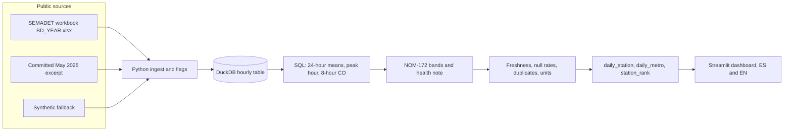

# Aire abierto

Lectura ciudadana de la calidad del aire en la zona metropolitana de Guadalajara, hecha con el archivo horario público de SEMADET. El código es MIT. Los datos son de la autoridad ambiental de Jalisco y se citan abajo.

Esto no es el sitio de una empresa, ni un portafolio ficticio, ni un aviso oficial. Es un proyecto cívico de datos abiertos para que cualquier persona pueda ver, en un año cerrado, qué estaciones pasaron más días en bandas peores y qué contaminante marcó ese día. Se preparó como herramienta de interés público junto con Edgar Flores.

A civic reading of air quality in the Guadalajara metropolitan area, built from SEMADET's public hourly file. The code is MIT. The measurements belong to Jalisco's environment secretariat and are credited below.

This is not a company site, not a fictional portfolio, and not an official alert. It is an open-data project for the public. It was prepared as a public-interest tool with Edgar Flores.

## Español

### Para qué sirve

El tablero responde tres preguntas sobre el archivo de **2025**:

1. ¿En qué banda quedó el peor punto de la ciudad cada día?
2. ¿Qué estaciones acumularon más días en Mala, Muy mala o Extremadamente mala?
3. ¿Qué se puede decir, en lenguaje llano, de ese día, en español y en inglés?

No dice cómo está el aire **ahora**. El archivo anual llega hasta el 31 de diciembre de 2025. Para hoy hay que abrir el [reporte horario de SEMADET](https://aire.jalisco.gob.mx/).

### Qué muestra el archivo de 2025

Estas cifras salen de `data/metrics`, construido con el libro `BD_2025.xlsx`. Son una lectura con las bandas de partículas vigentes desde enero de 2026, no la clasificación que regía durante 2025. En 2025 la banda Aceptable llegaba más arriba (PM2.5 hasta 33 µg/m³ y PM10 hasta 60).

- 13 estaciones, 113 880 horas, 365 días civiles.
- En **309 de 365 días** al menos una estación cayó en Mala o peor (224 Mala, 69 Muy mala, 16 Extremadamente mala). Solo 10 días quedaron en Buena en toda la red, bajo esta regla.
- Eso es la **peor estación del día**, que es lo que la norma pide difundir. No es el aire típico de la ciudad. La mediana diaria de PM2.5 entre estaciones con datos suficientes tuvo, a su vez, una mediana de unos **18 µg/m³**.
- **Santa Fe** sumó 254 días en Mala o peor (PM2.5 medio del año, 28 µg/m³). **Las Pintas** sumó 237 (31 µg/m³). Sus áreas de influencia publicadas incluyen El Salto, San Pedro Tlaquepaque y Tlajomulco de Zúñiga.
- **Santa Margarita** tuvo el PM2.5 medio más bajo, unos 11 µg/m³. En esa estación el día lo marcó más veces el ozono.
- El contaminante que fijó la peor estación del día fue PM2.5 en 196 días, PM10 en 93, ozono en 67 y NO2 en 9.
- El dióxido de azufre no trae número válido en el 63% de las horas. En **Miravalle** el canal de PM2.5 no tiene ni un día con 18 horas válidas: su banda sale de otros contaminantes, sobre todo PM10. No hay que leer eso como “ahí no hay partículas finas”.
- **Águilas** solo tiene banda en 290 días. Compararla con una estación de 365 días sin decirlo sería injusto.

### Cómo correrlo

```bash
python -m venv .venv
source .venv/bin/activate
pip install -e ".[dev]"

# Reconstruye el año 2025. Descarga ~12 MB de SEMADET si data/raw/ no lo tiene.
python -m aire_abierto.pipeline --source live --year 2025

# Tablero en http://127.0.0.1:8741
streamlit run dashboard/app.py
```

Sin red, el extracto público de 14 días (1 al 14 de mayo de 2025) y el archivo inventado no piden llaves:

```bash
python -m aire_abierto.pipeline --source sample --out build/excerpt
python -m aire_abierto.pipeline --source synthetic --out build/synthetic
```

`data/metrics` ya trae el año 2025. `--source sample` **sin** `--out` reemplaza esa carpeta. Para ver el extracto en el tablero, copia o genera ahí a propósito.

`--source auto` intenta la descarga y, si falla, usa el extracto. CI no depende de la red: corre el extracto y el sintético en `build/`.

### Fuentes

| Qué | Quién | Dónde |
| --- | --- | --- |
| Horas de O3, NO2, SO2, CO, PM10 y PM2.5 | SEMADET, red SIMAJ | [Datos históricos](https://aire.jalisco.gob.mx/Dhistoricos), archivo [`BD_2025.xlsx`](https://aire.jalisco.gob.mx/reportes/BD_2025.xlsx) |
| Nombres y municipios de influencia | SEMADET | Reporte diario ([numeralia](https://aire.jalisco.gob.mx/info/numeraliaimeca.pdf)) y documentos públicos de contingencia |
| Bandas y mensajes de riesgo | SEMARNAT | NOM-172-SEMARNAT-2023, DOF 25 de enero de 2024, tablas 4 a 9 y 12. Partículas: columna «A partir de enero de 2026» |

La página de datos históricos no publica una licencia SPDX. El código de este repositorio es MIT; eso no sustituye las condiciones de SEMADET sobre las mediciones. El extracto de mayo está en `data/samples/` para poder reconstruir sin red. El año completo no se versiona: se descarga del sitio oficial. No se entra a páginas con login ni se usan APIs de pago.

OpenAQ pide una llave gratuita y aquí no se usa. El portal de datos de la Ciudad de México publica un promedio diario de la RAMA, sin estación, bajo CC BY 4.0 (SEDEMA); en esta construcción el portal no respondió a tiempo y ese archivo no distingue estaciones, así que la serie de trabajo es la de Guadalajara.

Santa Margarita viene como **SMT** en el archivo de 2025. Documentos anteriores de SEMADET usaban **SMA** para el mismo nombre.

### Qué no es

No es el Índice AIRE y SALUD horario. No calcula el promedio móvil ponderado de 12 horas con el que la norma avisa durante el día. Para partículas usa el promedio de 24 horas, que es la referencia de riesgo de la norma, y solo si hay al menos 18 horas válidas. Para ozono, NO2 y SO2 usa la hora más alta del día, con la misma exigencia de 18 horas. Para CO usa el máximo de los promedios de 8 horas que tengan al menos 6 horas válidas. La hora 00:00 del archivo cierra el día civil anterior.

No es consejo médico ni un parte de contingencia.

## English

### What it is for

The dashboard answers three questions about the **2025** file:

1. Which band did the worst site in the city fall into each day?
2. Which stations collected the most days at Poor, Very poor, or Extremely poor?
3. What can be said about that day in plain Spanish and plain English?

It does not say what the air is like **right now**. The annual file ends on 31 December 2025. For today, open [SEMADET's hourly report](https://aire.jalisco.gob.mx/).

### What the 2025 file shows

These figures come from `data/metrics`, built from `BD_2025.xlsx`. Particle bands are the ones in force since January 2026, not the classification used during 2025. In 2025 the Acceptable band reached higher (PM2.5 up to 33 µg/m³ and PM10 up to 60).

- 13 stations, 113,880 hours, 365 civil days.
- On **309 of 365 days** at least one station was Poor or worse (224 Poor, 69 Very poor, 16 Extremely poor). Only 10 days were Good everywhere on the network, under this rule.
- That is the **worst station of the day**, which is what the standard says to publish. It is not the typical air in the city. The daily median of PM2.5 across stations with enough hours itself had a median of about **18 µg/m³**.
- **Santa Fe** had 254 days at Poor or worse (year-mean PM2.5, 28 µg/m³). **Las Pintas** had 237 (31 µg/m³). Their published areas of influence include El Salto, San Pedro Tlaquepaque, and Tlajomulco de Zúñiga.
- **Santa Margarita** had the lowest mean PM2.5, about 11 µg/m³. Ozone set the day there more often than particles.
- The pollutant that set the worst station was PM2.5 on 196 days, PM10 on 93, ozone on 67, and NO2 on 9.
- Sulfur dioxide has no valid number in 63% of hours. At **Miravalle** the PM2.5 channel has not a single day with 18 valid hours: its band comes from other pollutants, mostly PM10. That is a gap in the file, not a finding that fine particles are absent.
- **Águilas** has a band on only 290 days. Ranking it against a 365-day station without saying so would be unfair.

### How to run

```bash
python -m venv .venv
source .venv/bin/activate
pip install -e ".[dev]"

# Rebuild 2025. Downloads about 12 MB from SEMADET unless data/raw/ already has it.
python -m aire_abierto.pipeline --source live --year 2025

# Dashboard at http://127.0.0.1:8741
streamlit run dashboard/app.py
```

Offline, with no API key, use the committed 14-day public excerpt (1–14 May 2025) or the invented file:

```bash
python -m aire_abierto.pipeline --source sample --out build/excerpt
python -m aire_abierto.pipeline --source synthetic --out build/synthetic
```

`data/metrics` already holds 2025. Running `--source sample` **without** `--out` replaces that folder.

`--source auto` tries the download and falls back to the excerpt. CI never needs the network: it builds the excerpt and the synthetic file under `build/`.

### Sources

| What | Who | Where |
| --- | --- | --- |
| Hourly O3, NO2, SO2, CO, PM10, and PM2.5 | SEMADET, SIMAJ network | [Historical data](https://aire.jalisco.gob.mx/Dhistoricos), file [`BD_2025.xlsx`](https://aire.jalisco.gob.mx/reportes/BD_2025.xlsx) |
| Station names and areas of influence | SEMADET | Daily report ([numeralia](https://aire.jalisco.gob.mx/info/numeraliaimeca.pdf)) and public contingency documents |
| Bands and risk messages | SEMARNAT | NOM-172-SEMARNAT-2023, Official Gazette 25 January 2024, tables 4–9 and 12. Particles: column “from January 2026” |

The historical-data page does not state an SPDX license. The code in this repository is MIT. That license does not replace SEMADET's terms for the measurements. A May excerpt lives in `data/samples/` so the project rebuilds offline. The full year is not committed; download it from the official site. Nothing behind a login is scraped, and no paid API is called.

OpenAQ needs a free key and is not used. Mexico City's open-data portal publishes a citywide daily RAMA average, with no station, under CC BY 4.0 (SEDEMA). During this build that portal did not answer in time, and that file cannot rank stations, so the working series is Guadalajara's.

Santa Margarita is **SMT** in the 2025 file. Older SEMADET documents used **SMA** for the same name.

### What it is not

It is not the official hourly Índice AIRE y SALUD. It does not compute the 12-hour weighted average the standard uses as an intraday warning. Particles use the 24-hour mean, which is the standard's health reference, and only with at least 18 valid hours. Ozone, NO2, and SO2 use the highest hour of the day, with the same 18-hour rule. CO uses the highest 8-hour mean whose window has at least 6 valid hours. In the file, 00:00 closes the previous civil day.

It is not medical advice and it is not a contingency bulletin.

## Architecture



## Data quality

Each build writes `quality_report.json`. A check fails the process when there are no rows, duplicate station-hours, units that do not match ppm for gases and µg/m³ for particles, ozone and PM2.5 both empty in more than 95% of hours, or a live year file that does not cover that year. A warning does not fail the build. The 2025 file warns on purpose: it is a historical annual close, and sulfur dioxide is missing in most hours. Flagged cells (`ND`, `IO`, `IR`, `IF`, `IC`, and any other non-numeric token) stay empty.

## CI

GitHub Actions (`.github/workflows/ci.yml`) installs the package, runs Ruff, runs pytest, and builds dashboard data twice: once from the public excerpt and once from the synthetic file.

## License

The code is [MIT](LICENSE). Measurements stay attributed to SEMADET.
